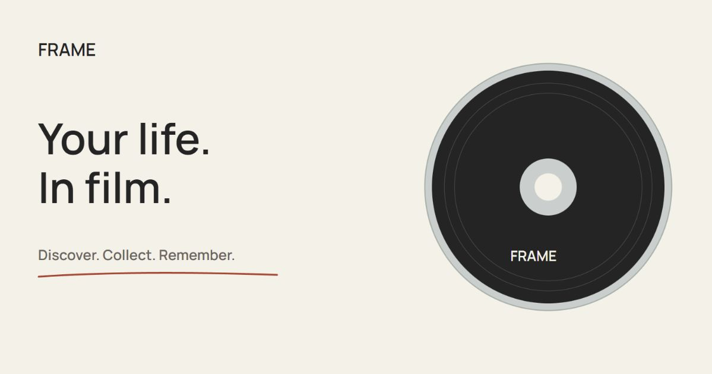

# FRAME

### Your life. In film.

A cinematic home for the films you discover, collect, and remember. FRAME pairs a tactile, disc-inspired interface with movie discovery, a personal film diary, and a community of film lovers.

**[Visit FRAME →](https://frame-1mu5.onrender.com/)**



## What you can do

- **Discover your next film.** Browse trending, popular, and highly rated movies, search titles, and explore films from your country.
- **Build a personal collection.** Keep a watchlist, create lists, and curate your favorite films.
- **Remember what you watch.** Log diary entries, ratings, and reviews with spoiler controls.
- **Explore the people behind a film.** Open cast and crew profiles, browse their credits, and find your next watch.
- **Connect over cinema.** Follow members, explore public profiles, and see activity from people you follow.
- **Ask Pip.** Use the optional AI movie companion for conversation and movie lookup.

The interface includes animated film discs, layered cast and crew badges, paper textures, keyboard navigation, and reduced-motion support.

## Built with

| Layer | Technology |
| --- | --- |
| Interface | React 19, Vite, Tailwind CSS, Three.js |
| API | Django 5.2, Django REST Framework |
| Database | PostgreSQL; SQLite fallback for a fresh local setup |
| Movie data and artwork | TMDB through the backend |
| Hosting | Render Docker service; Neon PostgreSQL in production |
| Optional AI | Gemini or OpenAI, configured server-side |

## Run locally

Requires **Node.js 22.12+**, npm, and **Python 3.12+**. Run the frontend and backend in separate terminals.

### 1. Clone the repository

```sh
git clone https://github.com/oujasya/frame.git
cd frame
```

### 2. Start the backend

The commands below use PowerShell on Windows:

```powershell
cd backend
python -m venv .venv
Copy-Item .env.example .env
.venv\Scripts\python -m pip install -r requirements.txt
```

Set `TMDB_READ_ACCESS_TOKEN` or `TMDB_API_KEY` in `backend/.env`, then run:

```powershell
.venv\Scripts\python manage.py migrate
.venv\Scripts\python manage.py runserver 127.0.0.1:8000
```

On macOS/Linux, use `python3 -m venv .venv`, `cp .env.example .env`, and `.venv/bin/python` in place of the Windows virtual-environment executable.

A fresh checkout uses SQLite when no database URL is configured. For PostgreSQL, set `DATABASE_URL` or `DJANGO_DATABASE_URL`. Root `.env.local` values are also loaded; use a development database for local work.

### 3. Start the frontend

From a second terminal at the repository root:

```powershell
cd frontend
Copy-Item .env.example .env
npm ci
npm run dev
```

On macOS/Linux, use `cp .env.example .env`.

Open **http://127.0.0.1:5173/**. Vite forwards `/api` requests to the local backend on port 8000. Keep `VITE_DEMO_MODE=false` to load live movies and leave `VITE_API_BASE_URL` blank for the same-origin proxy.

## Configuration

| Variable | Purpose |
| --- | --- |
| `TMDB_READ_ACCESS_TOKEN` / `TMDB_API_KEY` | Movie data; the read token takes precedence |
| `DATABASE_URL` / `DJANGO_DATABASE_URL` | PostgreSQL connection; absent values use local SQLite |
| `DJANGO_SECRET_KEY` | Required for production; local development creates an ignored key |
| `VITE_DEMO_MODE` | Set to `false` for live movies |
| `VITE_API_BASE_URL` | Leave blank for local proxy and Render same-origin hosting |
| `PIP_AI_PROVIDER` | Optional AI provider: `gemini` or `openai` |
| `GEMINI_API_KEY` / `OPENAI_API_KEY` | Server-side credential for the chosen AI provider |
| `SMTP_*` / `APP_PUBLIC_URL` | Optional verification and password-reset email delivery |

Use the committed `.env.example` files as templates. Keep real credentials out of Git and out of `VITE_` variables, which are included in the browser bundle. Movie discovery works independently of AI and SMTP configuration.

## Development checks

```sh
npm --prefix frontend run build
```

From `backend/`, using the Python executable from your virtual environment:

```sh
python manage.py check
python manage.py test core.test_people
```

The cast-profile tests mock upstream requests and do not require a TMDB credential.

## Deployment

The production app runs at **https://frame-1mu5.onrender.com/**. The root `render.yaml` and `Dockerfile.render` define a single Render service that builds React and serves the frontend, Django API, and admin under one HTTPS origin. Production data lives in Neon PostgreSQL.

Keep deployment credentials in Render environment settings. Production builds disable demo mode. Render's free service can take time to wake after inactivity.

## Repository map

```text
frontend/
  src/                  React views, motion, disc rendering, and styles
  public/               Artwork assets, textures, fonts, and social card
backend/
  config/               Django settings and URL routing
  core/                 Movie API, accounts, diary, lists, social, and Pip
Dockerfile.render       Production multi-stage image
render.yaml             Render service definition
```

## Further reading

- [Database setup](NEON_SETUP.md) and [PostgreSQL operations](POSTGRESQL.md)
- [Render deployment](RENDER_DEPLOY.md)
- [Email configuration](EMAIL_SETUP.md)
- [Pip AI configuration](PIP_AI.md)
- [Django migration history](DJANGO_MIGRATION.md)

Some supporting documents retain historical setup notes. This README is the entry point for the current React and Django application.

## Credits

Movie data and artwork are supplied by [TMDB](https://www.themoviedb.org/). This product uses the TMDB API but is not endorsed or certified by TMDB. Bundled fonts retain their license notices in `frontend/public/fonts/`.
